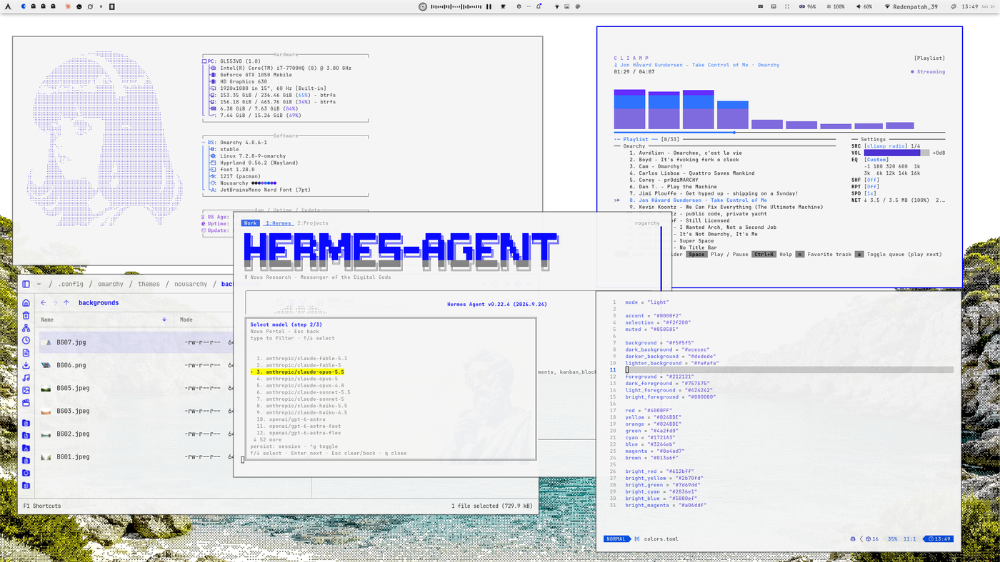

# nousarchy

Light theme for [Omarchy](https://omarchy.org).

<p align="center">
  
</p>

<p align="center"><sub>Bar: <a href="https://github.com/HANCORE-linux/Shibumi-Shell">Shibumi</a> · File manager: <a href="https://github.com/lgse/strata">Strata</a></sub></p>

## Contents

| File | Purpose |
| --- | --- |
| `colors.toml` | Full Omarchy palette (accent, backgrounds, foregrounds, ANSI + bright ANSI) |
| `icons.theme` | Icon theme name (currently `Yaru-purple`) |
| `backgrounds/` | Wallpaper set used with the theme |
| `preview.png` | Desktop preview |

## Backgrounds

| File | Size | Type |
| --- | --- | --- |
| `BG01.jpeg` | 2.9 MB | JPEG |
| `BG02.jpeg` | 2.1 MB | JPEG |
| `BG03.jpeg` | 1.4 MB | JPEG |
| `BG05.jpeg` | 1.9 MB | JPEG |
| `BG06.png` | 4.2 MB | PNG |
| `BG07.jpg` | 713 KB | JPEG |

## Install

```sh
omarchy theme install git@github.com:qyzh/nousarchy.git
```

Or clone straight into the themes directory:

```sh
git clone git@github.com:qyzh/nousarchy.git ~/.config/omarchy/themes/nousarchy
```

Then select `nousarchy` from the Omarchy theme picker.

## Colors

| Token | Value |
| --- | --- |
| Mode | `light` |
| Accent | `#0000f2` |
| Selection | `#f2f200` |
| Background | `#f5f5f5` |
| Dark background | `#ececec` |
| Darker background | `#dedede` |
| Foreground | `#212121` |
| Bright foreground | `#000000` |

## License

MIT — see [LICENSE](LICENSE).
